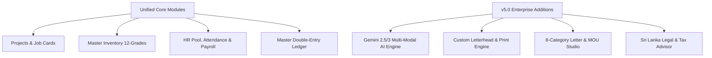
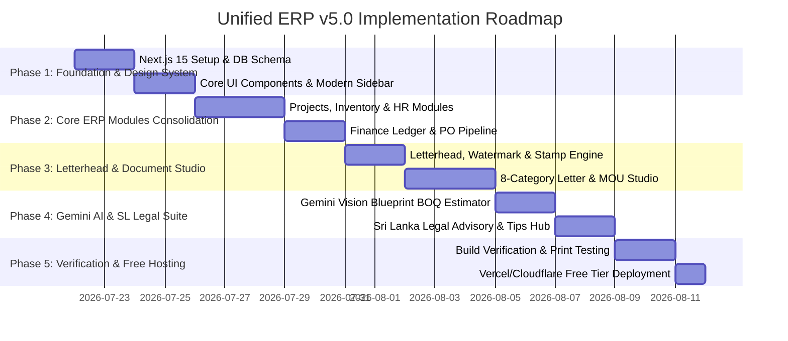

# Kekulawala Unified Enterprise ERP v5.0 — Comprehensive Architecture & Implementation Master Plan

## 1. Executive Summary & Vision
The **Kekulawala Unified Enterprise ERP v5.0** consolidates three standalone systems (System A - Business & HR, System B - Procurement & Inventory, System C - Quotations & AI Estimator) into a single, high-speed, modern enterprise platform.

In addition to core ERP functionalities (Projects, HR, Inventory, POs, Accounting), Version 5.0 introduces four flagship innovations:
1. **Next-Gen Gemini 2.5/3 Multi-Modal AI Core**: Deep computer vision for drawing/blueprint analysis, automated BOQ extraction, contract risk scoring, and executive voice/text operational insights.
2. **Custom Letterhead, Stamp & Watermark Engine**: Pixel-perfect A4 document rendering with custom letterhead headers, footers, digital stamps, authorized signatures, and opacity-controlled watermarks for Invoices, Quotations, POs, and Letters.
3. **Enterprise Letter & Agreement Studio**: Automated, AI-assisted document generator for 8+ critical business letter types (Advance Requests, Payment Reminders, RFQs, MOUs, Subcontractor Agreements, Transmittals).
4. **Sri Lanka Commercial, Industrial & Labor Legal Advisory Suite**: Built-in legal engine covering Sri Lankan Contract Law, Shop & Office Employees Act, EPF/ETF Regulations, CIDA/ICTAD Construction Standards, and Inland Revenue Tax (VAT/SSCL) with daily legal compliance tips and contract risk analysis.

---

## 2. Master System Feature Matrix

### Module Breakdown:

| Module | Core Functionality | Advanced AI Integration | Sri Lanka Legal & Document Enhancements |
| :--- | :--- | :--- | :--- |
| **Executive Command Center** | Overall KPIs, Cashflow, Active Projects, Low Stock Alerts | Gemini Daily Operational Insights & Anomaly Detection | **Daily Sri Lanka Legal & Compliance Tip Widget** |
| **Quotations & AI Estimator** | BOQ Builder, Tax/VAT, Margins, Discounts | Computer Vision Blueprint/Drawing Analysis, Material Alternatives | Custom Letterhead + Watermark + Stamp Print Engine |
| **Document & Letter Studio** | Document Archive & Transmission Tracking | AI Auto-Drafting of Custom Letters based on Project Context | **8 Automated Letter & Agreement Templates** (Advance, Reminders, MOUs, Contracts) |
| **Projects & Job Cards** | Work Orders, Milestones, Labor/Material Tracking | Cost Overrun Warning Prediction | Subcontractor & Client Legal Agreement Binding |
| **Inventory & Procurement** | 12 Material Grades, PO Stages, Reorder Alerts | Market Price Trend Intelligence (Rising/Falling) | Supplier Legal Agreement & PO Transmittal Letters |
| **Assets & Transport Logistics** | Equipment Depreciation, Vehicle Mileage & Driver Logs | Fuel & Route Cost Optimization | Vehicle Hire & Driver Service Agreements |
| **HR, Attendance & Payroll** | Employee/Subcontractor Pools, Daily Attendance, Payroll | Performance Evaluation Scoring | **SL Labor Law Compliance Check** (EPF/ETF, Shop & Office Act, Overtime rules) |
| **SL Legal & Tax Advisory** | Legal Knowledge Hub & Agreement Clauses | Gemini AI Contract Clause Audit & Risk Score | **Sri Lanka Commercial, Labor & Tax Guidance** (VAT, SSCL, CIDA, EPF) |
| **Master Financial Ledger** | Income/Expense Ledger, Client Receivables, Supplier Payables | Cashflow Forecasting | Tax Invoice Generation compliant with RAMIS / IRD SL |

---

## 3. Technology Stack & Free-Tier Optimization Strategy

To ensure zero hosting costs while achieving lightning-fast performance:

1. **Frontend & Framework**: **Next.js 15 (App Router)** with **TypeScript**, **React 19**, and **Tailwind CSS**.
   - Server Components for static rendering and instant page loads.
   - Client Components for interactive canvases and live print previews.
2. **Database & Storage**: **Supabase (PostgreSQL)**
   - 500MB Free PostgreSQL database.
   - Supabase Storage Bucket for user-uploaded Company Letterheads, Watermarks, Digital Signatures, Rubber Stamps, and Architectural Blueprint images.
3. **AI Framework**: **Google Gemini 2.5 / 3 API (via `@google/genai`)**
   - Free tier usage via Google AI Studio API Key.
   - Vision API for Blueprint/Drawing PDF & Image OCR/BOQ extraction.
   - Text/Reasoning API for legal clause analysis and professional letter drafting.
4. **Print & Document Export Engine**: **React-To-Print + Html2Canvas + PDFKit**
   - Renders exact A4 print dimensions (`210mm x 297mm`) with customizable margins, print headers, footers, background watermarks, and official stamps.
5. **Deployment**: **Vercel Hobby Plan** or **Cloudflare Pages** (Unlimited bandwidth, zero cost).

---

## 4. Feature Deep-Dive: New Enterprise Capabilities

### A. Advanced Gemini AI 2.5/3 Engine
- **Multi-Modal Blueprint Analyzer**: Users upload a project drawing (PNG, JPG, PDF). Gemini vision scans dimensions, material specifications, steel profiles, and lighting counts to auto-generate a complete Bill of Quantities (BOQ).
- **Material Smart Substitutes**: Suggests cost-effective alternatives (e.g. 4mm PVDF ACP vs 3mm PE ACP vs HPL) with pros/cons and price differential calculations.
- **Contract & Agreement Risk Auditor**: Scans draft agreements against Sri Lankan commercial law, flagging ambiguous payment terms, liability traps, or missing arbitration clauses.

### B. Custom Letterhead, Watermark & Stamp Engine
- **Letterhead Uploader & Designer**:
  - Top Header Image (e.g., logo, company registration number, address bar).
  - Bottom Footer Image (e.g., bank account details, ISO certifications, branch addresses).
  - Opacity-controlled Center Watermark (e.g., semi-transparent company logo).
  - Digital Authorized Signatures & Official Company Rubber Stamps with draggable position controls.
- **Supported Outputs**:
  - Official Quotations
  - Tax Invoices & Credit Notes
  - Purchase Orders (POs)
  - Payment Receipts
  - Official Business Letters & Agreements

### C. Enterprise Letter & Legal Agreement Studio
Provides 8 specialized, interactive document generators linked directly to CRM clients, projects, and inventory:

1. **Payment Advance Request Letter**: Formal request for mobilization advance (e.g. 50% upfront) referencing quotation number and bank details.
2. **Payment Overdue / Reminder Letter**: 3-stage payment collection letters (Gentle Reminder, Formal Request, Final Notice before legal action) with automatic interest penalty calculation.
3. **Thanking & Appreciation Letter**: Customer gratitude letters sent upon project completion or payment settlement, encouraging repeat business.
4. **Purchase Order (PO) Transmittal & RFQ Letter**: Formal request for vendor quotation or official purchase order issuance to material suppliers.
5. **Material Request Letter**: Internal/External formal requisition for site material release from central warehouse.
6. **Final Invoice Transmittal Letter**: Formal hand-over letter attaching final completion certificate and final bill.
7. **Memorandum of Understanding (MOU)**: Preliminary business agreement template for joint ventures, partnerships, or prospective large projects.
8. **Subcontractor & Service Level Agreement (SLA)**: Binding work agreement covering scope of work, defects liability period (DLP), payment milestones, and safety compliance.

### D. Sri Lanka Commercial & Industrial Legal Advisory Suite
Built specifically for Sri Lankan business environments:
- **Commercial & Industrial Law Knowledge Base**:
  - **Shop & Office Employees Act No. 19 of 1954**: Working hours, statutory leave (Casual, Annual, Medical), overtime calculation rules (1.5x normal rate).
  - **EPF & ETF Acts**: Statutory employer contributions (12% EPF + 3% ETF) and employee deductions (8% EPF).
  - **Taxation Regulations (Inland Revenue Dept SL)**: Value Added Tax (VAT 18%), Social Security Contribution Levy (SSCL 2.5%), WHT (Withholding Tax) compliance guidelines.
  - **Construction Industry Development Act (CIDA / ICTAD)**: Standard terms of contract, retention money rules (usually 5%), Defects Liability Period (6-12 months).
  - **Recovery of Loans / Debt Law**: Legal procedure for unpaid commercial bills, Letter of Demand (LOD) protocols, Civil Procedure Code provisions.
- **Daily Legal Tip Widget**: Displays a rotating daily legal/compliance tip on the executive dashboard to keep management informed of statutory obligations.

---

## 5. Comprehensive Database Schema Extensions

### `company_settings` (Letterhead & Stamps)
- `id`, `companyName`, `regNumber`, `vatNumber`, `address`, `phone`, `email`, `website`
- `headerImageUrl`, `footerImageUrl`, `watermarkImageUrl`, `watermarkOpacity`
- `stampImageUrl`, `signatureImageUrl`, `bankDetails` (JSON: Bank, Branch, Account No, SWIFT)

### `letters_and_agreements`
- `id`, `documentCode` (`LTR-2025-XXXX`, `MOU-2025-XXXX`, `AGR-2025-XXXX`)
- `category` ("advance_request" | "payment_reminder" | "appreciation" | "rfq_po" | "material_request" | "final_bill" | "mou" | "subcontractor_agreement")
- `clientId`, `clientName`, `projectRef`, `date`, `subject`, `bodyContent` (HTML/Markdown)
- `metaData` (JSON: advanceAmount, invoiceNo, overdueDays, workScope, DLP)
- `status` ("draft" | "issued" | "signed" | "archived")

### `legal_knowledge_base`
- `id`, `actName`, `category` ("labor" | "tax" | "contract" | "construction" | "debt_recovery")
- `summary`, `keyClauses` (JSON), `dailyTip`, `relevanceScore`

---

## 6. Execution & Implementation Roadmap

---

## 7. Verification & Testing Plan

### Automated Build Verification
- Command: `npm run build`
- Ensure zero TypeScript compiler errors, clean bundle compilation.

### Manual Verification Matrix
1. **Letterhead & Print Engine**: Test rendering a Quotation, Invoice, and Letter with header image, footer, opacity watermark, and digital stamp. Verify pixel accuracy in browser print dialog (A4 format).
2. **Letter Studio Test**: Generate a Payment Advance Request and an MOU document, verifying client data auto-population and Gemini AI text polish.
3. **Sri Lanka Legal Advisor Test**: Test legal knowledge lookup for EPF/ETF rate calculator, VAT 18% calculation, and daily compliance tips widget.
4. **Blueprint AI Estimator Test**: Upload a test drawing image and verify auto-generated BOQ item table.

---

> [!IMPORTANT]
> **Please review this enhanced, comprehensive implementation master plan.**
> If approved, we will begin Phase 1: Project setup and initial core architecture building!
